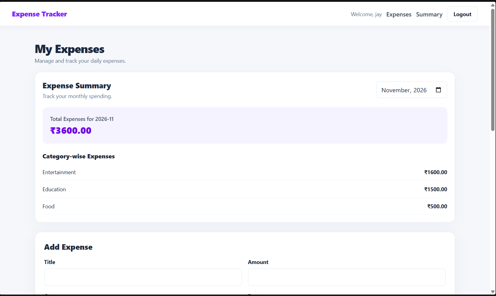

# Expense Tracker (React)

A responsive expense-tracking application built with React and Vite for users who want to manage and track their daily expenses.

**Live:** https://expense-react-delta.vercel.app/

**API:** [Expense API](https://github.com/Deeppatel2004/expense-api)

## Screenshot



## Features

- User registration and login
- Add, edit, and delete expenses
- Search expenses by title and notes
- Filter expenses by category and month
- Sort expenses
- View monthly expense summaries
- View category-wise spending breakdown
- View the biggest single expense
- Responsive design for mobile and desktop
- Protected routes

## Tech

- React
- JavaScript
- Vite
- React Router
- Tailwind CSS
- Vercel

## Run it locally

### 1. Clone the repository

```bash
git clone https://github.com/Deeppatel2004/expense-react.git
cd expense-react
```

### 2. Install dependencies

```bash
npm install
```

### 3. Configure environment variables

Copy `.env.example` to `.env`:

```bash
cp .env.example .env
```

Set the API URL in `.env`:

```env
VITE_API_URL=http://localhost:5000
```

Use your backend API URL if you are connecting to a deployed API.

### 4. Start the development server

```bash
npm run dev
```

Open the local URL displayed in your terminal.

## What I Would Add Next

- Add expense charts to make spending patterns easier to understand.
- Add an option to export expenses as CSV.
- Improve the dashboard with more useful financial insights.